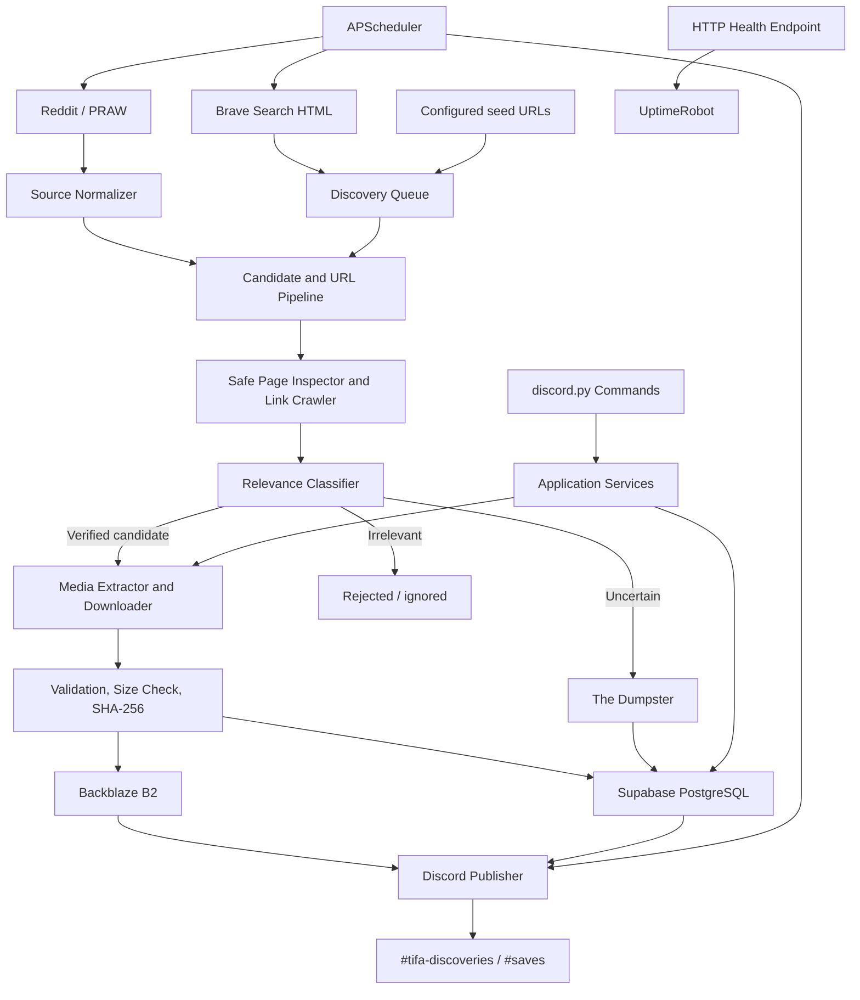

# Tifa Lockhart Bot — Version 1 Development Blueprint

**Project:** Tifa Lockhart Bot  
**Version:** 1.0 (locked V1 scope)  
**Developer:** SoftwareFromVish  
**Project owner:** Vish  
**Primary runtime:** Python 3.11.8  
**Deployment target:** Render Web Service  
**Document status:** Final development specification

---

## 1. Purpose and product definition

Tifa Lockhart Bot is a personal, automated media-discovery, acquisition, preservation, and delivery system dedicated to Tifa Lockhart.

The system discovers relevant material from Reddit and the wider public web, obtains the actual media files where they are directly and legitimately accessible, preserves the files and their provenance, records searchable metadata, and publishes verified finds to a dedicated Discord server.

V1 is not merely a downloader or a link-posting bot. Its core pipeline is:

> **Discover → inspect → verify → acquire → deduplicate → preserve → record → deliver.**

The archive may contain:

- Tifa Lockhart fanart and illustrations.
- Cosplay and photography.
- Official Tifa artwork and images.
- Wallpapers and image collections.
- Relevant GIFs and videos.
- Other clearly Tifa Lockhart-related public media.

The guiding principle is: **Discover broadly, verify carefully, preserve responsibly, and organize beautifully.**

## 2. Locked V1 decisions

The following decisions define the initial release and should not be re-opened during ordinary implementation.

| Area                         | V1 decision                                                                                                                      |
| ---------------------------- | -------------------------------------------------------------------------------------------------------------------------------- |
| Project name                 | Tifa Lockhart Bot                                                                                                                |
| Developer identity           | SoftwareFromVish                                                                                                                 |
| Language                     | Python 3.11.8                                                                                                                     |
| Discord integration          | `discord.py` 2.x, application/slash commands                                                                                     |
| Primary social source        | Reddit, through a modular PRAW connector                                                                                         |
| Web discovery                | Brave Search public HTML pages, parsed without using the Brave Search API, subject to applicable access rules and terms          |
| External web crawling        | Controlled link discovery, inspection, and direct media acquisition from eligible public pages                                   |
| Maximum crawl depth          | 6 levels, with seed URLs at depth 0                                                                                              |
| Media delivery               | Upload the actual media file to Discord; do not rely on remote preview embeds                                                    |
| V1 media formats             | JPG/JPEG, PNG, WebP, GIF, MP4, WebM                                                                                              |
| Maximum media size           | 10,000,000 bytes per file (10 MB decimal); larger files are skipped                                                              |
| Exact duplicate detection    | SHA-256                                                                                                                          |
| Similar-image detection      | Optional perceptual hash for still images; similarity is a review signal, not an automatic destructive merge                     |
| Metadata database            | Supabase PostgreSQL                                                                                                              |
| Binary media storage         | Backblaze B2, private bucket, S3-compatible access                                                                              |
| Uncertain discoveries        | The Dumpster, represented as a staging status in the database                                                                    |
| Platform collection schedule | Approximately hourly                                                                                                             |
| Brave discovery schedule     | Every 8 hours (inside the agreed 6–12-hour range)                                                                                |
| Daily digest                 | Every day at 4:00 AM Asia/Kolkata (IST)                                                                                          |
| Discord channels             | Minimal: `#tifa-discoveries` and `#saves`; category-specific destinations are optional configuration, not required channels      |
| Discord controls             | `/start`, `/stop`, `/save`, `/random`, `/status`, `/stats`, `/about`                                                             |
| Hosting                      | One Render Web Service containing the bot, scheduler, and health endpoint                                                        |
| Keep-awake monitor           | UptimeRobot HTTP monitor aimed at the Render health endpoint, configured for a 5-minute interval where the selected plan permits |
| Reddit comment trigger       | Excluded from V1; postponed                                                                                                      |
| Other platform connectors    | Pinterest and other platforms are future work, not V1 sources                                                                    |

### 2.1 Finalised operational defaults

Some values were deliberately left configurable in the planning document. V1 now uses these concrete starting defaults so the implementation has predictable boundaries:

| Control                                           |                                       V1 default |
| ------------------------------------------------- | -----------------------------------------------: |
| Maximum URLs admitted to one web-discovery job    |                                              300 |
| Maximum pages fetched from one domain in one job  |                                               20 |
| Maximum concurrent crawler requests               |                                       5 globally |
| Minimum delay between requests to the same domain |                                        2 seconds |
| Maximum HTML/page response body                   |                           5,000,000 bytes (5 MB) |
| Maximum redirects followed                        |                                                5 |
| Network timeout                                   |        10 seconds to connect; 20 seconds to read |
| Retry attempts                                    | 3 total attempts for eligible transient failures |
| Reddit candidates examined per hourly run         |           100 maximum across configured searches |
| Brave HTML discovery interval                     |                                    Every 8 hours |
| Digest delivery time                              |                            04:00, `Asia/Kolkata` |

These are configuration defaults, not permission to exceed a site's own limits. A stricter site limit, `Retry-After`, robots directive, access denial, or applicable policy always takes precedence.

## 3. V1 scope and exclusions

### Included in V1

1. Reddit discovery through the PRAW connector, using broad searches rather than a single hard-coded subreddit.
2. Brave Search HTML result-page discovery without using the Brave Search API.
3. Recursive, depth-limited link discovery across eligible public websites.
4. URL normalization, duplicate detection, domain budgets, request throttling, retry handling, SSRF protection, and provenance tracking.
5. Relevance classification using available post/page metadata and text.
6. The Dumpster for uncertain, incomplete, or temporarily uninspectable discoveries.
7. Media extraction and download for the supported V1 formats.
8. A strict 10 MB-per-file ceiling.
9. SHA-256 deduplication and optional still-image perceptual hashing.
10. Private Backblaze B2 storage and Supabase metadata persistence.
11. Discord media-file delivery with creator and source attribution.
12. Manual URL saving through `/save`.
13. Random archive retrieval, status, statistics, and project information commands.
14. Hourly Reddit collection, 8-hour Brave discovery, and the 4:00 AM IST digest.
15. Render deployment, HTTP health endpoint, UptimeRobot monitoring, logging, and restart recovery.

### Explicitly excluded from V1

- Pinterest or any other additional platform-specific connector.
- Reddit comment monitoring or the `u/TifaCollector save` trigger.
- Login-based crawling, cookies copied from a browser, authenticated-page scraping, paywall bypass, DRM removal, CAPTCHA solving, or anti-bot evasion.
- A separate web dashboard or public-facing archive website.
- AI image recognition or a hosted LLM-based classifier. V1 classification is metadata/text based.
- Bulk re-encoding, image enhancement, watermark removal, or unnecessary recompression.
- Automatic immediate publication of every crawler discovery. Automated verified discoveries are batched into the daily digest; manual `/save` is immediate.
- Automatic deletion or expiry of archived media. V1 keeps retained objects until the owner explicitly requests removal or a rights/access issue requires it.
- Multi-instance or horizontally scaled deployment. V1 runs one application instance to avoid duplicate schedulers and conflicting jobs.

## 4. System architecture

The collector must operate independently of Discord command handling wherever practical. Discord is the user-control and delivery interface; it is not the source of truth for the archive.



### 4.1 Logical components

| Component                 | Responsibility                                                                                                            |
| ------------------------- | ------------------------------------------------------------------------------------------------------------------------- |
| Reddit connector          | Search Reddit broadly, inspect submissions, extract available post and creator metadata, and locate original media assets |
| Brave discovery adapter   | Fetch public Brave Search result HTML at a conservative interval and extract candidate external URLs                      |
| Discovery queue           | Store candidate URLs, queue state, depth, parent, source, and retry information                                           |
| Safe crawler              | Inspect eligible public pages, extract links, enforce domain and request budgets, and stop restricted traversal paths     |
| Relevance classifier      | Classify candidates as verified, uncertain, or irrelevant using text and metadata signals                                 |
| The Dumpster              | Hold uncertain or incomplete candidates for owner review; prevent them from being auto-published as verified finds        |
| Media extractor           | Identify original media files and supported source-specific media variants; avoid thumbnail-only fallbacks                |
| Media downloader          | Stream and validate supported media within the hard size ceiling                                                          |
| Deduplicator              | Compute SHA-256, check existing assets, and optionally calculate image perceptual hashes                                  |
| B2 storage adapter        | Store immutable media objects in the private bucket                                                                       |
| Repository/database layer | Persist discoveries, media records, source provenance, job runs, and publications in Supabase                             |
| Discord publisher         | Upload actual files, attach attribution, route by category, and track publication status                                  |
| Discord command layer     | Expose the V1 command set and invoke application services                                                                 |
| Scheduler                 | Run hourly, 8-hour, and daily jobs in the configured timezone                                                             |
| Health server             | Expose a minimal HTTP endpoint for Render and UptimeRobot                                                                 |

### 4.2 Runtime architecture

V1 runs as **one Render Web Service and one Python application process**. That process starts:

- The Discord Gateway client.
- The APScheduler `AsyncIOScheduler`.
- The HTTP health server bound to `0.0.0.0:$PORT`.
- The shared application services and connection clients.

This keeps the Discord bot and scheduler in the same service that UptimeRobot monitors. Do not split the scheduler or bot into a separate worker in V1: a ping to a separate web service would not keep a separate worker active.

The local filesystem is temporary working space only. Media that must survive a restart is stored in B2; metadata and job state are stored in Supabase.

## 5. Source strategy and discovery

### 5.1 Reddit — primary source

Reddit is the only platform-specific connector in V1. The connector uses PRAW and performs broad searches across Reddit (including `r/all`) instead of relying on a fixed list of subreddits.

Initial configurable search phrases:

- `Tifa Lockhart`
- `Tifa Lockhart fanart`
- `Tifa cosplay`
- `Tifa Lockhart cosplay`
- `Tifa Final Fantasy VII`

For the recurring collection job:

1. Search using the configured phrases, sorted by newest where supported.
2. Examine no more than 100 candidate submissions per job across all phrases.
3. Deduplicate overlapping results by Reddit submission ID.
4. Record submission ID, permalink, title, body/caption, subreddit, author, author profile URL when available, timestamps, and relevant media metadata.
5. Pass each candidate into the shared verification and media pipeline.
6. Store source IDs and links even when the media is skipped or the extraction fails.

The existing Python/PRAW downloader is a starting point for the connector. Reuse its proven gallery, direct-image, and Reddit-video handling where appropriate, but refactor it into modules. It is not the finished bot.

**Access gate:** the implementation may include the PRAW connector, configuration, and tests, but production data access must use credentials and access that are actually authorized under the platform's current requirements. Do not disguise the use case, evade access limits, or treat a successful test request as proof of permission. If authorization is not available, disable the Reddit collection job and report the condition in `/status` and logs rather than attempting a workaround.

### 5.2 Brave Search — web discovery

Brave Search is used to discover candidate external URLs, not as a media host and not as a substitute for permission to access a result's destination site.

V1 will use HTML parsing of public Brave Search result pages without calling the Brave Search API, as decided. The adapter should:

1. Run the configured search phrases every 8 hours.
2. Fetch only the number of result pages needed for the 300-URL job budget.
3. Parse result titles, snippets, and destination URLs from the returned HTML.
4. Normalize and deduplicate destinations before queueing them.
5. Retain the query and result-page URL as discovery provenance.
6. Discard search-page navigation, advertisements, and non-destination links.

The HTML parser must be isolated behind a `BraveSearchAdapter` interface because result-page markup can change. Parser failures should create a job error and alert through logs/status; they must not cause aggressive retries.

**Important operating condition:** using HTML rather than an API does not itself establish permission to automate access. Before enabling the live scraper, confirm that the intended access complies with Brave's current Terms of Use and any applicable access restrictions. Keep requests conservative. If Brave returns a CAPTCHA, proof-of-work challenge, access denial, 403, or other anti-automation barrier, stop that discovery run and disable or pause the adapter for review. Do not solve challenges automatically, spoof browser fingerprints, rotate identities/IPs to evade controls, or otherwise bypass a restriction. If the method is not permitted or becomes blocked, the Brave adapter must remain disabled until an allowed discovery method is selected.

### 5.3 External website inspection

The generic web crawler only inspects eligible public HTTP/HTTPS pages. It is not a general-purpose browser automation system.

For each page it may:

- Read the page title, description, canonical URL, Open Graph/Twitter metadata, visible text, and creator attribution where available.
- Extract relevant outbound links and enqueue them within crawl budgets.
- Detect direct links to supported image, GIF, or video files.
- Inspect image elements and `srcset` values to identify a higher-resolution original when accessible.
- Extract direct downloadable media URLs from ordinary static HTML.

It does not execute arbitrary page JavaScript, sign into websites, copy authenticated browser cookies, solve challenges, bypass paywalls, bypass DRM, or download content from restricted pages.

A generic page's `og:image` or social preview is not automatically considered the original artwork. Prefer a direct original-file link, full-resolution image variant, or source-specific media endpoint. If only a thumbnail/preview is available and no original can be established, send the candidate to The Dumpster or mark media extraction as unavailable; do not fall back to a low-quality branded preview just to produce an attachment.

## 6. Recursive discovery and crawler controls

### 6.1 Link-hopping workflow

Example path:

`Reddit post → artist profile → artist website → portfolio page → additional Tifa artwork`

For every newly discovered candidate:

1. Normalize the URL and remove tracking parameters where safe to do so.
2. Validate the scheme and destination address.
3. Check whether the normalized URL has already been seen.
4. Record its parent discovery, discovery source, and current depth.
5. Add it to the queue if it is eligible and within the configured budget.
6. Fetch and inspect the page using the safe crawler.
7. Extract metadata, media candidates, and child links.
8. Classify the candidate.
9. Route verified media to the acquisition pipeline, uncertain findings to The Dumpster, and irrelevant findings to the rejected state.
10. Queue eligible child links at `depth + 1`, up to depth 6.

Seed URLs have depth 0. The crawler may fetch and expand nodes through depth 6; it must not enqueue child nodes at depth 7.

### 6.2 Required crawl budgets

Every discovery job must enforce all of the following independently:

- Maximum 300 unique candidate URLs admitted to a job.
- Maximum 20 pages fetched per domain per job.
- Maximum 5 concurrent crawler requests globally.
- Minimum 2-second spacing between requests to the same domain.
- Maximum 5,000,000-byte response body for an HTML/page fetch.
- Maximum 5 redirects followed for one request.
- Connect timeout of 10 seconds and read timeout of 20 seconds.
- Maximum crawl depth of 6.
- URL and domain duplicate detection.
- A per-domain request history and failure state.

If one domain reaches a limit, crawling for that domain pauses for the rest of the job. Other eligible domains and discovery paths continue.

### 6.3 Retries and status codes

- Retry eligible transient network failures and HTTP 5xx responses up to 3 total attempts, using exponential backoff with jitter.
- On HTTP 429, obey `Retry-After` when present. Do not retry sooner than that instruction.
- On HTTP 401 or 403, abandon that URL's traversal path immediately. Do not keep following its descendants or retry around the restriction. Other unrelated crawl paths continue.
- Treat CAPTCHA/challenge pages and explicit bot blocks as restricted paths; do not attempt to bypass them.
- Record permanent failures, final status code, retry count, and last error.

### 6.4 SSRF and network safety

Before fetching a URL, the crawler must:

- Accept only `http` and `https` schemes.
- Reject loopback, private, link-local, multicast, reserved, and otherwise non-public IP ranges for both IPv4 and IPv6.
- Resolve and validate destination addresses, including after redirects; reject redirects to prohibited addresses.
- Reject local hostnames and internal service names.
- Limit redirects, response size, request time, concurrency, and per-domain rate.
- Avoid forwarding authorization headers, cookies, or secrets to discovered sites.
- Never fetch cloud metadata endpoints or internal service endpoints.

The same validation applies to user-supplied URLs passed to `/save`.

### 6.5 Crawl provenance

Every queued or fetched discovery must preserve:

- Original discovered URL and normalized URL.
- Discovery method (`reddit`, `brave_html`, `seed`, or `manual_save`).
- Search phrase or source record that produced it, where applicable.
- Parent discovery ID and parent URL.
- Crawl depth.
- Domain and timestamps.
- HTTP status, retry count, and terminal state.

This makes every archived media item traceable to its path of discovery.

## 7. Relevance classification and The Dumpster

### 7.1 V1 classifier

V1 uses a deterministic metadata/text classifier. It evaluates available information such as:

- Post title and body/caption.
- Search phrase and result snippet.
- Page title and description.
- Hashtags, tags, category labels, and source metadata.
- Recognizable Final Fantasy VII context in the surrounding text.

It does not claim to visually understand an image. An image with no reliable textual or source metadata should not be auto-promoted solely because its URL appeared in a Tifa-related search result.

Classification outcomes:

| Outcome    | Meaning                                                                      | Action                                                                                                          |
| ---------- | ---------------------------------------------------------------------------- | --------------------------------------------------------------------------------------------------------------- |
| `verified` | Strong textual/source evidence that the item is Tifa-related                 | Eligible for media acquisition and the daily digest                                                             |
| `dumpster` | Potentially relevant, ambiguous, incomplete, or not confidently attributable | Store as an unverified candidate for owner review                                                               |
| `rejected` | Clearly irrelevant, unsupported, or unsuitable                               | Do not acquire or publish; retain only the minimal decision/audit record needed for deduplication and debugging |

Classifier rules and keyword lists must be configurable in one place. The threshold should be conservative: false positives should go to The Dumpster rather than the verified collection.

### 7.2 The Dumpster

The Dumpster is a staging status/category in Supabase, not a separate media archive and not a mandatory Discord channel.

It holds:

- Links that might contain Tifa artwork but are not yet confirmed.
- Newly discovered creators or portfolios with incomplete verification.
- Pages with incomplete metadata.
- Potentially relevant pages whose extraction failed or needs another inspection.
- Candidates where only a preview/thumbnail is visible and the original media is not yet located.

Owner review operations for V1:

1. Inspect the discovery record and its source/provenance in Supabase.
2. Promote a confirmed candidate to `verified` and re-queue the media pipeline if necessary.
3. Mark an irrelevant candidate `rejected`.
4. Re-queue an eligible transient failure for another bounded inspection attempt.

V1 does not add a new Discord command or dashboard just for Dumpster management. The review surface is the Supabase dashboard/database using the stored status fields. Do not publish Dumpster items in the daily digest.

## 8. Media acquisition and validation

### 8.1 Media-first rule

The system's normal media workflow is:

1. Discover the source post/page.
2. Identify the actual media asset(s).
3. Resolve the best available original/full-resolution file URL.
4. Download the bytes.
5. Validate type and size.
6. Compute hashes and check duplicates.
7. Store the file in B2.
8. Commit metadata and source provenance to Supabase.
9. Queue the verified asset for Discord delivery.

Discord receives the actual file attachment. A source URL or external preview alone does not count as successful media delivery.

### 8.2 Supported formats

V1 accepts:

- Images: `.jpg`, `.jpeg`, `.png`, `.webp`.
- Animation: `.gif`.
- Video: `.mp4`, `.webm`.

Validate the actual content type and file signature where possible; do not trust an extension or remote `Content-Type` header on its own. Unsupported formats are skipped and recorded. No V1 promise is made for containers/codecs outside this list.

### 8.3 File-size ceiling

The hard maximum is **10,000,000 bytes per individual media file**.

- Check `Content-Length` before downloading when available.
- Stream the response and stop as soon as the byte counter exceeds the limit.
- For `yt-dlp`-assisted sources, configure the maximum-file-size constraint and verify the final downloaded size before accepting the asset.
- If a file exceeds the limit, mark it `oversize`/`skipped`; do not upload it to B2 or Discord.
- Preserve the source URL and a concise skip reason in the database.

Do not silently compress or transcode an oversized original to force it under the limit. The owner may change the global limit in a later version, but V1 uses the limit above.

### 8.4 Source-specific extraction

**Reddit galleries:** use gallery metadata to locate original media variants. Do not treat low-resolution preview images as the final asset when the original is available.

**Reddit images:** use direct supported image URLs and the best available original source URL.

**Reddit videos:** use the available Reddit video media endpoint or `yt-dlp` where it can obtain the public media without login, DRM removal, or access-control bypass. Verify the resulting file format and size.

**External websites:** prefer direct downloadable media links, original-resolution image variants, or clearly exposed media sources. Do not use a page's branded thumbnail as a substitute for the original.

**Manual `/save`:** the submitted URL goes through the same safety, file-type, and size checks. The user explicitly requested the save, so the classifier may mark the item as a manual save; manual intent does not bypass access restrictions, type validation, or the 10 MB cap.

### 8.5 Preservation rules

- Preserve the original downloaded bytes wherever practical.
- Do not recompress or transform media unnecessarily.
- Preserve original source URLs, source platform, post/page IDs, and creator attribution when available.
- Sanitize filenames before temporary use or storage.
- Never execute downloaded files.
- Clean temporary files after storage/publication or after a failed operation.
- Record download/extraction errors rather than silently dropping candidates.

## 9. Deduplication

### 9.1 Exact duplicate detection — required

Compute SHA-256 over the final validated file bytes. The SHA-256 value is unique for a media asset and is protected by a database uniqueness constraint.

When an asset with the same SHA-256 already exists:

- Do not store a second physical copy in B2.
- Do not create a second media asset record.
- Add the new source/post/creator/provenance record to the existing asset's source list.
- Do not automatically publish the exact same asset again to the discoveries channel.
- A manual `/save` may still reply that the file is already archived and provide its saved/source information; it should not duplicate the physical object.

### 9.2 Perceptual similarity — optional enhancement within V1

For still images, the system may compute a perceptual hash using Pillow and an image-hash library. It is a similarity hint for finding resized or lightly altered copies.

- Perceptual hashing is not required for videos in V1.
- Similarity alone must not automatically delete, overwrite, or merge two items.
- Store candidate similarity information or flag it for review.
- Keep SHA-256 as the authoritative exact-duplicate key.

## 10. Storage and database design

### 10.1 Supabase PostgreSQL — metadata and application state

Supabase is the source of truth for structured data. Store metadata and object references in PostgreSQL, not media binaries.

V1 should use schema migrations checked into the repository. The application connects through the Supabase Python client or a controlled PostgreSQL connection; all secrets stay in environment variables.

### 10.2 Backblaze B2 — media objects

B2 stores the actual media files in a **private bucket**. V1 object keys are content-addressed and independent of classification, so reclassifying an item does not require moving the object.

Object-key pattern:

```text
assets/{first_two_sha256_characters}/{sha256}.{extension}
```

Example shape (illustrative only):

```text
assets/ab/abcdef...1234.webp
```

Storage rules:

- Bucket access is private; do not expose an open public bucket in V1.
- Store bucket name, object key, MIME type, size, and SHA-256 in Supabase.
- Use the S3-compatible B2 endpoint and credentials from environment variables.
- Upload only after the file passes validation and duplicate checks.
- Do not apply an automatic object-expiration lifecycle rule to archived media in V1.
- Retain archived objects until the owner explicitly removes them or a rights/access issue requires removal.
- Discord publishing fetches the private object through the bot's B2 client and uploads it as an attachment; the bot does not need to expose the B2 object publicly.
- B2 retains object versions. Deleting a verification object through the S3-compatible API may hide the current version rather than permanently removing historical versions. Routine verification must delete only the exact `healthchecks/<uuid>.txt` object it created and must never perform bucket-wide or prefix-wide version deletion.
- A lifecycle rule scoped to the `healthchecks/` prefix may expire temporary verification objects and their non-current versions after a short interval. Do not extend that rule to `assets/` or the whole bucket.
- The verification command must report cleanup failure as an incomplete verification and exit nonzero.

### 10.3 Core database tables

Use UUID primary keys unless a platform-native ID is more appropriate. Store timestamps in UTC (`timestamptz`) and convert to `Asia/Kolkata` only for display and schedule calculations.

#### `discoveries`

One record per normalized URL/page or source candidate.

| Field                                        | Purpose                                                                                                      |
| -------------------------------------------- | ------------------------------------------------------------------------------------------------------------ |
| `id`                                         | Internal UUID                                                                                                |
| `url`                                        | Original URL                                                                                                 |
| `normalized_url`                             | Deduplication key; unique where applicable                                                                   |
| `source_type`                                | `reddit`, `brave_html`, `seed`, or `manual_save`                                                             |
| `source_platform_id`                         | Reddit post ID or other native ID when available                                                             |
| `title`, `description`                       | Extracted text metadata                                                                                      |
| `creator_name`, `creator_profile_url`        | Attribution metadata when available                                                                          |
| `domain`                                     | Normalized host/domain                                                                                       |
| `parent_discovery_id`                        | Parent node in the discovery graph                                                                           |
| `depth`                                      | Crawl depth, 0–6                                                                                             |
| `status`                                     | `queued`, `processing`, `verified`, `dumpster`, `rejected`, `blocked`, `failed`, or `oversize` as applicable |
| `http_status`, `retry_count`, `last_error`   | Fetch diagnostics                                                                                            |
| `discovered_at`, `fetched_at`, `verified_at` | Lifecycle timestamps                                                                                         |
| `reviewed_at`, `reviewed_by`, `review_note`  | Owner review audit fields for The Dumpster                                                                   |
| `metadata_json`                              | Additional source-specific metadata                                                                          |

#### `discovery_edges`

One record per observed parent-to-child URL relationship. This preserves multiple paths to the same normalized URL even when the canonical `discoveries` row is deduplicated. Store `parent_discovery_id`, `child_discovery_id` (or the normalized child URL before its row exists), `discovered_from_url`, `depth`, and `discovered_at`, with a uniqueness constraint on the normalized edge.

#### `media_items`

One record per unique physical media file.

| Field                                               | Purpose                                                                               |
| --------------------------------------------------- | ------------------------------------------------------------------------------------- |
| `id`                                                | Internal UUID                                                                         |
| `sha256`                                            | Unique exact content hash                                                             |
| `perceptual_hash`                                   | Nullable still-image similarity hash                                                  |
| `filename`, `extension`, `mime_type`                | File metadata                                                                         |
| `media_type`                                        | `image`, `animation`, or `video`                                                      |
| `category`                                          | `fanart`, `cosplay_photography`, `official_artwork`, `wallpaper`, `video`, or `other` |
| `size_bytes`, `width`, `height`, `duration_seconds` | Technical metadata where available                                                    |
| `storage_bucket`, `storage_object_key`              | Private storage reference                                                             |
| `verification_status`                               | `verified` or `dumpster`                                                              |
| `favorite`                                          | Boolean, default false                                                                |
| `download_status`                                   | `stored`, `failed`, or `skipped`                                                      |
| `created_at`, `downloaded_at`                       | Lifecycle timestamps                                                                  |

Storage references use provider-neutral column names: `storage_bucket` and `storage_object_key`. They store the private Backblaze B2 bucket name and object key; the SHA-256 uniqueness and deduplication rules are unchanged. The checked-in migration `002_provider_neutral_storage_columns.sql` renames the historical `r2_*` columns in place for databases where `001_initial_schema.sql` was already applied, preserving existing data.

#### `media_sources`

One record per source attribution for an asset. This allows identical files found on multiple posts/sites to retain every source.

| Field                                 | Purpose                                          |
| ------------------------------------- | ------------------------------------------------ |
| `id`                                  | Internal UUID                                    |
| `media_item_id`                       | Related asset                                    |
| `discovery_id`                        | Related discovery record                         |
| `source_platform`, `source_post_id`   | Platform and native ID                           |
| `source_url`                          | Original post/page URL                           |
| `media_url`                           | Direct media URL, when safe and useful to retain |
| `creator_name`, `creator_profile_url` | Creator credit                                   |
| `caption`, `title`                    | Source text                                      |
| `discovered_at`                       | Source discovery time                            |

Add uniqueness constraints to prevent duplicate source records for the same asset and normalized source.

#### `publications`

One record per attempted Discord delivery.

| Field                         | Purpose                                    |
| ----------------------------- | ------------------------------------------ |
| `id`                          | Internal UUID                              |
| `media_item_id`               | Asset being sent                           |
| `channel_id`                  | Discord destination channel                |
| `message_id`                  | Discord message ID after success           |
| `purpose`                     | `daily_digest`, `manual_save`, or `random` |
| `status`                      | `pending`, `published`, or `failed`        |
| `attempt_count`, `last_error` | Retry diagnostics                          |
| `created_at`, `published_at`  | Delivery timestamps                        |

Use idempotency/unique constraints for a media item, destination channel, and automatic-digest purpose so scheduler retries do not create duplicate digest posts. Manual saves and random retrievals are separately recorded as delivery events.

#### `job_runs`

Record each scheduled or manually triggered job:

- Job type (`reddit_collection`, `brave_discovery`, `crawl`, `daily_digest`, or `manual_save`).
- Start/end time, outcome, counts processed, counts stored, counts skipped, and error summary.
- Job configuration snapshot or key parameters.

#### `runtime_state`

Persist bot runtime controls, including the collection-enabled flag and last successful job timestamps. `/start` and `/stop` update this record so the setting survives a Render restart.

#### `digest_state`

Persist the last successful digest window/cursor and its completion time. A digest must be idempotent and recoverable after an interrupted run.

### 10.4 Database integrity and migrations

- Put SQL migrations under `migrations/` and apply them in order.
- Enforce SHA-256 uniqueness in PostgreSQL, not only in Python.
- Use foreign keys for discoveries, media items, sources, and publications.
- Use indexes for normalized URL, SHA-256, status, category, discovered/downloaded timestamps, and publication status.
- Use transactions when committing related database changes.
- Do not mark a media item as stored until the B2 upload has succeeded and its object key is known.
- On partial failures, keep enough state to resume without duplicating the file or Discord post.

## 11. Discord server and delivery

### 11.1 Minimal channel structure

Required channels:

- `#tifa-discoveries` — verified automatic finds delivered through the daily digest.
- `#saves` — items explicitly saved through `/save`.

All automated items can use `#tifa-discoveries` in the default V1 server. Optional category-specific channel IDs may be configured later without changing the pipeline, but additional channels are not required for V1. The Dumpster is stored in Supabase and does not require a Discord channel.

### 11.2 Publication format

For every published media item:

1. Upload the actual file as a Discord attachment.
2. Include the title/caption where available.
3. Include category and creator attribution where available.
4. Include a clickable original source URL.
5. Include source platform/native post ID when available.
6. Include a short note if attribution is incomplete rather than inventing a creator name.

Do not post only an external preview embed in place of a file attachment. Do not fabricate missing attribution.

### 11.3 Daily digest behaviour

- The digest runs daily at 04:00 `Asia/Kolkata`.
- It selects verified media items that have not yet been successfully published to their configured discovery destination.
- It routes items by category if a category channel mapping exists; otherwise it uses `#tifa-discoveries`.
- It uploads actual media attachments and posts attribution alongside each item.
- It splits delivery into multiple Discord messages as needed to respect current Discord upload/message limits.
- A successful post is recorded in `publications` with its Discord message ID.
- Failed items remain pending/failed and are eligible for a later bounded retry; one failed file must not prevent unrelated items from publishing.
- The digest completion cursor is committed only after the run has been safely recorded. Successful per-item publication records prevent duplicates if the process restarts partway through.
- V1 does not automatically publish every verified item immediately. The daily digest is the automatic publication path.

### 11.4 `/save` behaviour

`/save <url>` processes one user-submitted Reddit post or supported public URL through the same URL safety and media pipeline. It:

- Validates the URL and rejects unsafe/internal destinations.
- Attempts to identify and acquire the original supported media file(s).
- Enforces format and 10 MB checks.
- Stores a new asset or reuses the existing exact duplicate.
- Saves source attribution and the requesting user's action.
- Immediately uploads the actual media file(s) to `#saves`.
- Returns a clear result when no original supported file can be extracted, the content is oversized, the URL is blocked, or the item is already archived.

A manual save must not bypass access controls, authentication, or platform restrictions.

## 12. Discord command specification

All commands are Discord application/slash commands. Commands operate only in the configured bot server. `/start` and `/stop` are owner-only using `OWNER_DISCORD_ID`; other commands may be used by members of the configured server unless owner-only configuration is chosen at deployment.

| Command   | Parameters                               | Behaviour                                                                                                                                                                                                                                                                               |
| --------- | ---------------------------------------- | --------------------------------------------------------------------------------------------------------------------------------------------------------------------------------------------------------------------------------------------------------------------------------------- |
| `/start`  | None                                     | Sets the persistent collection-enabled flag to true. Resumes scheduled Reddit collection and web discovery. It does not reconnect/disconnect the Discord bot because the bot remains online.                                                                                            |
| `/stop`   | None                                     | Sets the persistent collection-enabled flag to false. Pauses automated source collection and discovery. It does not disconnect the bot. Already stored items may still be delivered by the daily digest; manual `/save`, `/random`, `/status`, `/stats`, and `/about` remain available. |
| `/save`   | `url` (required)                         | Acquires a supported public media URL/post and publishes the actual file to `#saves` immediately.                                                                                                                                                                                       |
| `/random` | None                                     | Selects one random verified archived asset, retrieves its file from B2, and sends it with attribution in the command channel.                                                                                                                                                           |
| `/status` | None                                     | Shows Discord connection state, collection enabled/paused state, last successful Reddit and Brave runs, last digest, current backlog, and latest job error if any.                                                                                                                      |
| `/stats`  | `period`: `week`, `month`, or `lifetime` | Shows total unique archived assets and total successful media delivery events for the selected period; show image/video breakdown where metadata permits.                                                                                                                               |
| `/about`  | None                                     | Shows bot name, purpose, V1 version, developer (`SoftwareFromVish`), and configured developer/contact/project links. Do not invent unavailable contact information.                                                                                                                     |

### 12.1 `/start` and `/stop` semantics

These commands control **collection and discovery**, not the Discord connection or entire Python process. The scheduler and health server stay alive. The persistent runtime flag is read during startup and checked before each automatic source/discovery job. This prevents a restart from accidentally re-enabling a bot that the owner intentionally stopped.

The daily digest is a delivery job, not a new discovery job. It may publish already-collected verified backlog after `/stop`; this behaviour is intentional. `/save` is a direct user-requested operation and remains available while scheduled collection is paused.

### 12.2 Statistics definitions

- **Unique archived assets:** count of distinct `media_items` stored by the relevant timestamp.
- **Delivered files:** count of successful attachment delivery events in `publications` for the selected period.
- **Week:** current calendar week in `Asia/Kolkata`.
- **Month:** current calendar month in `Asia/Kolkata`.
- **Lifetime:** all retained records.

Show archived and delivered totals separately so repeated manual/random sends do not inflate the unique archive count.

## 13. Scheduling and job behaviour

Use APScheduler's asyncio scheduler with timezone `Asia/Kolkata`. Jobs must have overlap protection, coalescing, bounded retries, and persistent job-run records.

| Job               | Schedule                                                    | Work                                                                                                                             |
| ----------------- | ----------------------------------------------------------- | -------------------------------------------------------------------------------------------------------------------------------- |
| Reddit collection | Every 1 hour                                                | Search configured terms, inspect up to 100 candidates total, enqueue/process submissions                                         |
| Brave discovery   | Every 8 hours                                               | Parse public Brave result pages for configured terms and enqueue candidate URLs, only while the adapter is enabled and permitted |
| Crawl processing  | Runs after discovery and/or on a short internal queue cycle | Process queued URLs within the budgets and depth limit                                                                           |
| Daily digest      | Every day at 04:00 IST                                      | Publish verified, not-yet-published assets to the configured Discord destinations                                                |
| Health endpoint   | Always available                                            | Return process health; independent of collection enabled/paused state                                                            |

### 13.1 Reliability and restart behaviour

- Persist job state in Supabase; do not rely on the in-memory scheduler as the only record of work.
- On startup, reload the collection-enabled flag and queued work.
- Use a database/job lock or single-instance assumption to prevent simultaneous duplicate executions.
- Configure jobs to avoid overlapping instances of the same job.
- If the process misses the 04:00 digest because of a restart, perform a catch-up digest on startup when one is due; idempotency records prevent duplicate posts.
- If a job fails, record the error and continue unrelated jobs.
- Do not let one blocked domain or failed Reddit query bring down the full application.

## 14. Technology stack and project structure

### 14.1 Selected stack

| Purpose                      | Technology                                                                                    |
| ---------------------------- | --------------------------------------------------------------------------------------------- |
| Runtime                      | Python 3.11.8                                                                                  |
| Discord bot                  | `discord.py` 2.x                                                                              |
| Reddit connector             | PRAW                                                                                          |
| Async HTTP and health server | `aiohttp`                                                                                     |
| HTML parsing                 | BeautifulSoup4 with `lxml`                                                                    |
| Scheduler                    | APScheduler (`AsyncIOScheduler`)                                                              |
| Database                     | Supabase PostgreSQL using the Supabase Python client or controlled PostgreSQL access          |
| Object storage               | Backblaze B2 through its S3-compatible API (`boto3`, called off the event loop where needed) |
| Video acquisition            | `yt-dlp` for supported public Reddit video paths only where permitted                         |
| Image metadata               | Pillow                                                                                        |
| Perceptual hash              | ImageHash or equivalent optional library                                                      |
| Configuration                | Environment variables; `.env` for local development only                                      |
| Tests                        | `pytest`, async test support, mocks for external services                                     |

PRAW is synchronous; its network operations must run outside the Discord asyncio event loop (for example, through `asyncio.to_thread` or a bounded executor). Do not block the bot's event loop with synchronous network or storage work.

### 14.2 Suggested repository structure

```text
tifa-lockhart-bot/
├── app/
│   ├── main.py                 # Application startup and shutdown
│   ├── config.py               # Typed environment configuration
│   ├── logging_config.py       # Structured logging setup
│   ├── bot/
│   │   ├── client.py           # discord.py client setup
│   │   ├── commands.py         # Slash command registrations
│   │   └── publisher.py        # Discord file publishing
│   ├── connectors/
│   │   ├── base.py             # Connector interfaces and normalized records
│   │   ├── reddit.py           # PRAW Reddit connector
│   │   └── brave_html.py       # Brave public HTML parser
│   ├── discovery/
│   │   ├── queue.py            # Discovery queue operations
│   │   ├── crawler.py          # Safe, budgeted page crawler
│   │   ├── url_safety.py       # URL validation and SSRF protection
│   │   ├── extractor.py        # Page metadata/link/media extraction
│   │   └── classifier.py       # Metadata/text relevance rules
│   ├── media/
│   │   ├── downloader.py       # Streamed media acquisition
│   │   ├── reddit_media.py     # Gallery/video-specific extraction
│   │   ├── validator.py        # Type, signature, size validation
│   │   ├── hashing.py          # SHA-256 and optional perceptual hash
│   │   └── metadata.py         # Image/video technical metadata
│   ├── storage/
│   │   ├── b2.py               # B2 object storage adapter
│   │   └── temp_files.py       # Temporary file management
│   ├── db/
│   │   ├── client.py           # Supabase/database client
│   │   ├── repositories.py     # Data access methods
│   │   └── models.py           # Typed records and database models
│   ├── jobs/
│   │   ├── scheduler.py        # APScheduler setup
│   │   ├── collection.py       # Reddit and discovery job orchestration
│   │   ├── crawl.py            # Queue worker
│   │   └── digest.py           # Daily digest job
│   └── health/
│       └── server.py           # /healthz endpoint
├── migrations/
│   ├── 001_initial_schema.sql
│   └── ...
├── tests/
│   ├── unit/
│   ├── integration/
│   └── fixtures/
├── scripts/
│   ├── register_commands.py
│   └── healthcheck.py
├── .env.example
├── .gitignore
├── requirements.txt
├── README.md
└── render.yaml                # Optional Render Blueprint configuration
```

The exact file names may be adjusted during coding, but the separation of connectors, discovery, media, storage, database, jobs, and Discord responsibilities must remain.

## 15. Configuration and secrets

All credentials and deploy-specific IDs must be environment variables. Never commit `.env`, tokens, API secrets, or service-role keys.

Expected configuration:

```dotenv
# Application
APP_ENV=development
APP_VERSION=1.0.0
LOG_LEVEL=INFO
TIMEZONE=Asia/Kolkata
PORT=10000

# Discord
DISCORD_TOKEN=
DISCORD_GUILD_ID=
OWNER_DISCORD_ID=
DISCORD_DISCOVERIES_CHANNEL_ID=
DISCORD_SAVES_CHANNEL_ID=

# Optional category routing; leave empty to use the discoveries channel
DISCORD_CATEGORY_CHANNELS_JSON={}

# Reddit / PRAW
REDDIT_CLIENT_ID=
REDDIT_CLIENT_SECRET=
REDDIT_USER_AGENT=
REDDIT_ACCESS_APPROVED=false
REDDIT_ENABLED=true
REDDIT_MAX_ITEMS_PER_RUN=100

# Brave HTML discovery
BRAVE_HTML_ENABLED=false
BRAVE_SEARCH_BASE_URL=https://search.brave.com/search
BRAVE_SEARCH_INTERVAL_HOURS=8

# Supabase
SUPABASE_URL=
SUPABASE_SERVICE_ROLE_KEY=

# Backblaze B2
B2_ENDPOINT_URL=
B2_REGION=
B2_BUCKET_NAME=
B2_KEY_ID=
B2_APPLICATION_KEY=

# Limits
MAX_MEDIA_BYTES=10000000
MAX_PAGE_BYTES=5000000
MAX_CRAWL_DEPTH=6
MAX_URLS_PER_JOB=300
MAX_PAGES_PER_DOMAIN=20
MAX_CONCURRENT_REQUESTS=5
PER_DOMAIN_DELAY_SECONDS=2
MAX_REDIRECTS=5
```

`BRAVE_HTML_ENABLED` defaults to false until the operator has confirmed that the specific automated HTML access method is permitted and configured. `REDDIT_ACCESS_APPROVED` is an explicit deployment gate; do not set it true until the required permission is actually in place. Secrets should be supplied through Render's environment-variable settings in deployment, not baked into the repository or image.

The sample values above describe configuration names and safe defaults; actual tokens, IDs, URLs, and contact links must be supplied by the project owner.

## 16. Render deployment and UptimeRobot

### 16.1 Render service

Deploy one Render Web Service running the combined application process. The web server must bind to `0.0.0.0` and the port supplied by Render through `$PORT`.

The process starts the health server, Discord client, scheduler, and recovery routines. The HTTP server is not a separate business application; it exists as the health surface for the same process.

### 16.2 Health endpoint

Implement:

- `GET /healthz` — returns HTTP 200 with a small response when the process and event loop are alive.

The health endpoint should not require a Discord token or reveal secrets, channel IDs, environment variables, database credentials, or internal exception details. It should be lightweight and should not fail merely because Reddit or Brave is temporarily unavailable. Detailed dependency and collection state belongs in `/status` and internal logs.

Configure Render's health-check path as `/healthz` where available. Configure UptimeRobot as an HTTP/HTTPS monitor for the public Render health URL.

### 16.3 UptimeRobot keep-awake intent

Use UptimeRobot to request `/healthz` every 5 minutes where the selected plan supports that interval. This is intended to provide inbound activity to the Render Web Service and reduce idle spin-downs.

This is a keep-awake strategy, **not an uptime guarantee**. Render can restart a free service, free instances have resource/usage restrictions, and unusually high service-initiated outbound traffic may also trigger suspension. A monitor cannot prevent an outage, deploy restart, usage suspension, or provider-side interruption. The application must always recover safely from a restart.

Render's free web-service filesystem is ephemeral. Therefore:

- Never use local disk as the permanent archive.
- Store media in B2 and metadata/state in Supabase.
- Use local disk only for bounded temporary downloads and clean it up.
- Persist the collection-enabled flag, queued discoveries, publication state, and digest state outside the process.

Keep the bot and scheduler in the same Render service for V1. A separate worker would not be kept awake merely by pinging the web endpoint of a different service.

## 17. Error handling, observability, and operational safety

### 17.1 Error isolation

Every source and every media item must fail independently wherever possible:

- A Reddit API error does not stop Brave discovery.
- A Brave parser failure does not stop Reddit collection.
- A 401/403 page abandons only its traversal path.
- An oversized file does not abort its parent job.
- A failed B2 upload leaves the database record recoverable and must not be marked stored.
- A Discord upload failure leaves the publication pending/failed and eligible for a later retry.
- A daily digest continues with other assets when one attachment fails.

### 17.2 Logging

Write logs to standard output for Render log collection. Use structured fields where practical:

- Timestamp and severity.
- Job ID and job type.
- Connector/source type.
- Discovery ID and media ID.
- Domain and HTTP status, without exposing sensitive query tokens.
- Retry count and terminal state.
- Counts for discovered, verified, dumpster, rejected, downloaded, duplicate, oversized, stored, and published items.

Never log access tokens, service-role keys, signed URLs containing secrets, or full exception payloads that may contain credentials.

### 17.3 Status visibility

`/status` should report:

- Discord connection state.
- Whether scheduled collection is enabled or paused.
- Reddit connector state and latest successful run.
- Brave adapter enabled/disabled state and latest successful run.
- Last successful digest time.
- Queue backlog count.
- Number of Dumpster candidates awaiting review.
- Recent failed-job summary.

### 17.4 Data and rights handling

Preserve creator attribution and original source links whenever available. Use only content that is publicly and legitimately accessible through an allowed method. A private Discord server does not automatically grant redistribution rights. Respect platform policies, source-site terms, robots directives, takedown requests, copyright restrictions, and rate limits. If a source disallows collection or redistribution, do not fetch or publish that content.

Do not bypass authentication, paywalls, DRM, CAPTCHAs, anti-bot controls, or access restrictions. When uncertain, keep the item in The Dumpster or skip it rather than force acquisition.

## 18. Development implementation sequence

Build one end-to-end vertical slice first, then add discovery breadth. The purpose is to prove the core pipeline before investing in recursive crawling.

### Phase 1 — Foundation

- Create the Python project and dependency lock/requirements file.
- Implement typed configuration and secret handling.
- Set up structured logging and graceful shutdown.
- Create the Discord client and register the V1 slash commands.
- Create the Supabase project and initial SQL migrations.
- Create the private B2 bucket and verify upload/download operations.
- Add the `/healthz` HTTP endpoint.

**Exit condition:** application starts locally, connects to Discord, connects to Supabase/B2, and responds to `/status` and `/about`.

### Phase 2 — One working Reddit-to-Discord vertical slice

- Refactor the existing PRAW prototype into a Reddit connector.
- Normalize a Reddit submission into the internal candidate model.
- Extract one original supported image/video file.
- Enforce type and size limits.
- Compute SHA-256 and deduplicate.
- Upload the file to B2.
- Store metadata and source attribution in Supabase.
- Upload the actual file to `#saves` or a test discoveries channel with attribution.

**Exit condition:** one real, eligible Reddit candidate can travel from source to B2, database, and Discord without relying on an external preview.

### Phase 3 — Media reliability and archive metadata

- Support Reddit galleries and supported video retrieval.
- Add robust streaming downloads and temporary-file cleanup.
- Add media metadata extraction.
- Add source-provenance records for duplicate discoveries.
- Add optional perceptual hashes for still images.
- Add failure recovery for partial B2/database operations.

**Exit condition:** multiple supported media items process reliably, duplicates do not create duplicate B2 objects, and every stored file has traceable provenance.

### Phase 4 — Reddit automation and controls

- Add broad hourly Reddit search with the 100-item cap.
- Persist job runs and collection state.
- Implement `/start`, `/stop`, `/save`, `/random`, `/status`, `/stats`, and `/about` fully.
- Confirm PRAW access is authorized before enabling live collection.

**Exit condition:** hourly collection can run, stop, resume, survive restart, and expose accurate command/status information.

### Phase 5 — Brave discovery and controlled crawler

- Implement the Brave HTML adapter behind a feature flag.
- Confirm the planned HTML access method is permitted before enabling it.
- Add URL normalization, SSRF protection, link extraction, and discovery queue.
- Implement all crawl budgets, depth tracking, status handling, and per-domain throttling.
- Add text/metadata relevance classification and The Dumpster.

**Exit condition:** a permitted Brave result can lead to a bounded chain of eligible public pages, with provenance and correct handling of 401/403, 429, 5xx, blocked paths, and uncertain results.

### Phase 6 — Digest and publication reliability

- Implement category routing with `#tifa-discoveries` fallback.
- Implement the 04:00 IST daily digest.
- Implement per-item publication status and idempotency.
- Add catch-up after downtime and bounded retry for failed attachments.
- Ensure manual saves publish immediately to `#saves`.

**Exit condition:** the daily digest can be interrupted and restarted without duplicate posts or loss of eligible items.

### Phase 7 — Render deployment and acceptance testing

- Deploy the one-process web service to Render.
- Configure environment variables and health checks.
- Configure UptimeRobot against `/healthz`.
- Verify scheduler timing in `Asia/Kolkata`.
- Test Render restart recovery and persistence through Supabase/B2.
- Validate upload failures, rate limits, crawler budgets, and blocked paths.

**Exit condition:** the deployed application recovers from restarts, keeps its durable state, publishes according to schedule, and exposes clear status/errors.

## 19. V1 acceptance checklist

V1 is ready for release only when all applicable checks below pass.

### Foundation and persistence

- [ ] Bot starts and connects to the configured Discord server.
- [ ] `/healthz` returns HTTP 200 and exposes no secrets.
- [ ] Supabase migrations create all required tables, indexes, and uniqueness constraints.
- [ ] B2 bucket is private and the application can upload and retrieve objects.
- [ ] No durable state depends on Render's local filesystem.

### Reddit and acquisition

- [ ] Reddit searches are broad and not restricted to a single subreddit.
- [ ] Candidate cap is enforced at 100 per scheduled Reddit run.
- [ ] Gallery originals, direct images, and eligible public Reddit videos are handled.
- [ ] Low-resolution preview fallback is not used as a substitute for an unavailable original.
- [ ] Unsupported formats and files above 10,000,000 bytes are skipped with recorded reasons.
- [ ] PRAW live collection remains disabled unless access is authorized.

### Discovery and crawler

- [ ] Brave HTML access is behind a feature flag and enabled only after the access method is confirmed permissible.
- [ ] URL normalization and duplicate detection work.
- [ ] Depth never exceeds 6.
- [ ] URL, domain, concurrency, response-size, redirect, timeout, and per-domain delay budgets are enforced.
- [ ] 401/403 abandons only the affected path.
- [ ] 429 and 5xx handling uses bounded retry and does not evade rate limits.
- [ ] SSRF validation blocks private/internal destinations and unsafe redirects.
- [ ] Uncertain findings enter The Dumpster and are not auto-published.

### Media and archive

- [ ] SHA-256 exact duplicates reuse the stored object and retain new source attribution.
- [ ] Optional perceptual hashes only flag similar still images; they do not destructively merge assets.
- [ ] Original source URL and creator attribution are recorded where available.
- [ ] B2 object key follows the content-addressed V1 layout.
- [ ] Temporary files are cleaned up after processing.

### Discord and automation

- [ ] Every successful discovery publication includes the actual media attachment, not only a preview/embed.
- [ ] `#saves` receives manual `/save` items immediately.
- [ ] `/random` retrieves and sends a stored asset with attribution.
- [ ] `/start` and `/stop` pause/resume collection without disconnecting the bot.
- [ ] `/status` reports connection, collection state, latest jobs, backlog, and relevant errors.
- [ ] `/stats` separates unique archive counts from successful delivery counts for week, month, and lifetime.
- [ ] `/about` reports the correct project and developer information.
- [ ] The digest runs at 04:00 IST and safely catches up after a missed run.
- [ ] Interrupted publication does not create duplicate digest posts.

### Deployment

- [ ] Render serves the combined bot, scheduler, and health endpoint in one service.
- [ ] UptimeRobot checks the health endpoint at the configured interval.
- [ ] Restart recovery reloads runtime state and pending work from Supabase.
- [ ] Logs are useful and contain no secrets.
- [ ] The application continues unrelated work when one source, URL, domain, or media item fails.

## 20. Final V1 operating model

When deployed and enabled, Tifa Lockhart Bot operates as follows:

1. The hourly Reddit job searches broadly for Tifa-related submissions and sends eligible candidates into the common pipeline.
2. Every 8 hours, the Brave discovery adapter searches configured Tifa-related phrases using the approved public HTML access method and adds new external URLs to the discovery queue.
3. The crawler inspects eligible public pages and follows relevant outbound links up to six levels, while enforcing all URL, domain, timing, response, concurrency, and safety limits.
4. The relevance classifier sends strong matches to verification, uncertain findings to The Dumpster, and irrelevant candidates to rejection.
5. The media pipeline locates original supported files, validates their true format and size, computes hashes, and skips files above 10 MB.
6. Exact duplicates reuse the existing B2 object while preserving each distinct source and creator record.
7. New media files are stored in the private B2 bucket; metadata and source history are stored in Supabase.
8. At 4:00 AM IST, the digest publishes verified, not-yet-published media as actual Discord file attachments with source and creator attribution.
9. A user can invoke `/save <url>` at any time to process a supported public URL and immediately publish its actual file(s) to `#saves`.
10. `/random`, `/status`, `/stats`, and `/about` provide archive retrieval and visibility; `/start` and `/stop` control automatic collection without disconnecting the bot.
11. If Render restarts, the bot restores its persistent runtime setting, queued discoveries, and publication state from Supabase and resumes safely.

**The V1 deliverable is a working, restart-safe personal Tifa media archive with Reddit collection, controlled Brave-based web discovery, original-file acquisition, provenance-aware storage, and scheduled Discord delivery.**

---

## 21. Operational references

These links are included for deployment and access-policy verification. Review the current versions before launch because provider plans and policies can change.

- [Render — Free instance limitations](https://render.com/docs/free)
- [Render — Web services and port binding](https://render.com/docs/web-services)
- [UptimeRobot — Monitoring interval](https://help.uptimerobot.com/en/articles/11360876-what-is-a-monitoring-interval-in-uptimerobot)
- [Reddit — Responsible Builder Policy](https://mods.reddithelp.com/hc/en-us/articles/16693988535309-Moderation-Bots-Tooling)
- [Brave — Terms of Use](https://brave.com/terms-of-use/)

**End of Version 1 blueprint.**
